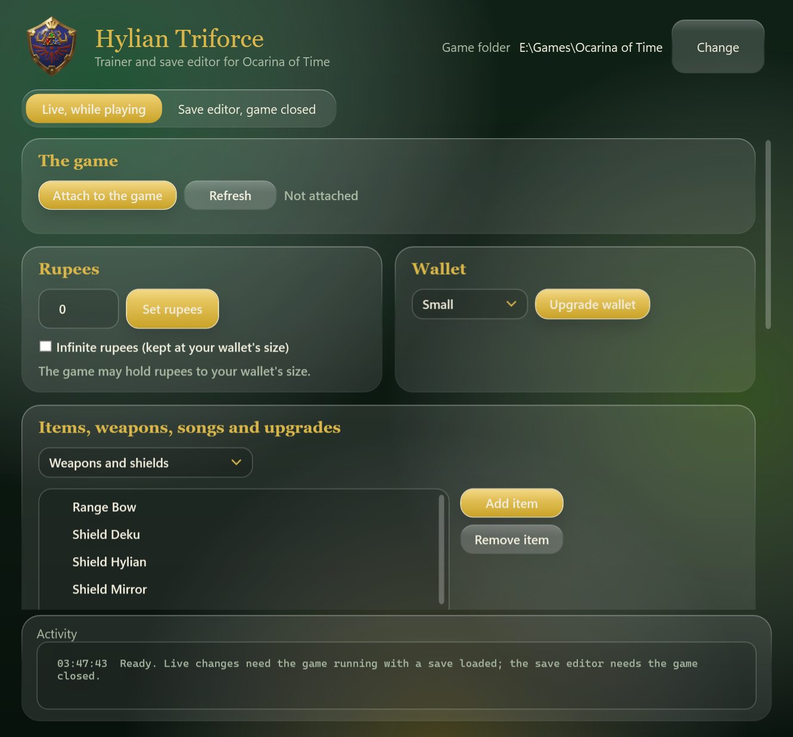
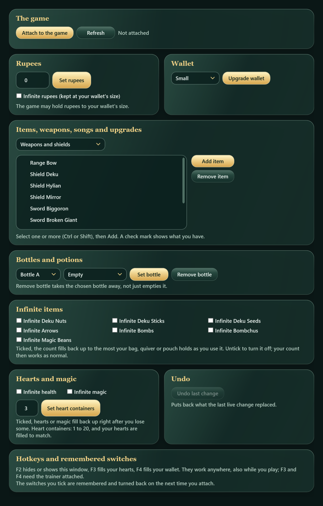
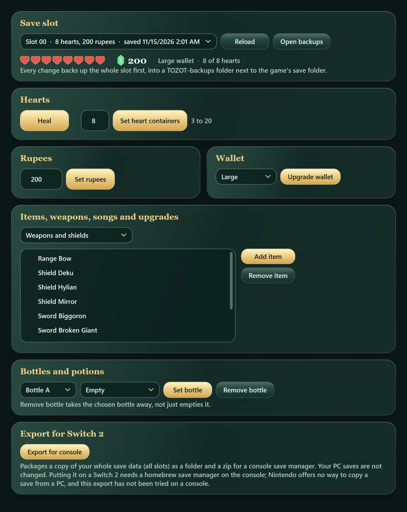

# Hylian Triforce Trainer & Save Editor

A Windows trainer and save editor for **The Legend of Zelda: Ocarina of Time**, running as the native PC port (`ocarina.exe`, the Ocarina Recomp / OcarinaDLSS build).

It has two halves:

- **Live, while playing:** it attaches to the running game and changes things as you play, such as infinite hearts, items and rupees, or adding items and heart containers.
- **Save editor, game closed:** it edits your save files directly, backing up the whole slot first.



---

## Features

### Live, while playing

| | |
|---|---|
| **Attach to the game** | Finds `ocarina.exe` and checks the game's data tables against the expected layout before writing anything. |
| **Rupees and wallet** | Set your rupees, upgrade your wallet, or tick **Infinite rupees** to keep the wallet full (99 / 200 / 500). |
| **Items, weapons, songs and upgrades** | Add or remove any item by category, several at once. A check mark shows what you already have. |
| **Bottles and potions** | Put anything in any of the five bottles: a fairy, potions, a fish, a bug and so on. |
| **Infinite items** | Deku Nuts, Deku Sticks, Deku Seeds, Arrows, Bombs, Bombchus and Magic Beans. Each refills to the most your bag, quiver or pouch holds, and only once you can carry it. |
| **Infinite health** | Your hearts fill back up right after every hit. |
| **Infinite magic** | Your magic meter refills as you use it, once you have one. |
| **Heart containers** | Set 1 to 20 heart containers while you play; your hearts fill to match. |
| **Undo** | Puts back whatever the last live change replaced. |
| **Hotkeys** | **F2** hides or shows the trainer, **F3** fills your hearts and **F4** fills your wallet. They work even while the game is in front. |
| **Remembered switches** | Whatever you had ticked turns back on the next time you attach. |



### Save editor, game closed

| | |
|---|---|
| **Save slots** | Lists every slot with its hearts, rupees and save time. |
| **Automatic backups** | Before each change, the whole slot is copied into `profile\TOZOT-backups`. **Open backups** shows the folder. |
| **Hearts** | Heal, or set 3 to 20 heart containers. |
| **Rupees, wallet, items, bottles** | The same choices as the live tab, written into the save file. |
| **Export for Switch 2** | Packages a copy of all your save data as a folder and a zip for a console save manager. Your PC saves are not changed. This export has not been tried on a console. |



---

## Install

1. Download **Hylian.Triforce.Setup.exe** from [Releases](../../releases/latest).
2. Run it and click **Install**. It installs for your Windows account only and needs no administrator rights. It adds a Start menu shortcut, an optional desktop shortcut and an entry in **Settings → Apps**.
3. Running the setup again updates it. It also replaces an older install from when the trainer was called **TOZOT**.

To uninstall, use **Settings → Apps → Hylian Triforce Trainer & Save Editor → Uninstall**. Your game, saves and save backups are not touched.

**Needs:** Windows 10 or 11 (64-bit) and the [.NET 10 Desktop Runtime](https://dotnet.microsoft.com/download/dotnet/10.0).

## How to use

1. Start the game and load your save.
2. Open the trainer and click **Attach to the game**.
3. Tick switches or make changes. The Activity box at the bottom says what was done.
4. For the save editor, close the game first and pick the game folder (the one containing `Ocarina of Time.exe`) with **Change**.

---

## How it works

**Live changes.** The PC port keeps the game's state in a GameData manager. It holds typed tables (Bool, Int, Enum) of records named by MurmurHash3 hashes from the game's own schema, `GameDataList.Product.110`. The trainer finds a field the same way the game does: it looks up the hash, then checks the table index and the record's descriptor. If anything doesn't match, it writes nothing.

**Hearts and magic.** A game system keeps these in its own small handle object, `{class pointer, value, name hash}`, and sends that value to GameData every frame. Writing only the GameData record is undone the next frame. So for these meters the trainer finds the handle in memory and writes there, and the game's own record follows it.

**Save files.** The save editor reads and writes the same records in `progress.sav` and keeps the file size unchanged.

## Building from source

```bash
dotnet publish -c Release -p:PublishSingleFile=true -o publish
```

The output is one `Hylian Triforce Trainer & Save Editor.exe`. A copy whose name contains "setup" opens the installer window.

There are hidden self-test modes that write a log file and show no window:

| Mode | Checks |
|---|---|
| `--selftest-items <log>` | Every infinite-item refill and the rupee write, against the running game |
| `--selftest-health <log>` | Finding the hearts handle, a hit, the refill, and setting heart containers |
| `--selftest-live <log>` | A live set, read back, undo, and read back again |
| `--selftest-save <game dir> <log>` | Each save-editor action on a slot, then a read-back |

`--shots <dir> [game dir]` renders the pictures above.

## Project layout

| File | What it does |
|---|---|
| `GameMemory.cs` | Attaching, verified record lookups, writes with undo, and the handle search |
| `Fields.cs` | The field names and table indexes, matched to the game's schema |
| `Ammo.cs` | Infinite-item rules: bag sizes and what each item needs |
| `Health.cs` | Hearts, magic and heart-container handles |
| `SaveFile.cs` | Reading and writing save files, and slot backups |
| `MainWindow.cs` | The window, both tabs, switches and hotkeys |
| `Setup.cs` | The per-user installer and uninstaller |
| `Theme.cs`, `Glass.xaml` | The look |

---

This is an unofficial fan tool, not affiliated with or endorsed by Nintendo. *The Legend of Zelda* and *Ocarina of Time* are trademarks of Nintendo. Use it with your own game and saves. Keep backups, though the save editor makes one before every change anyway.
